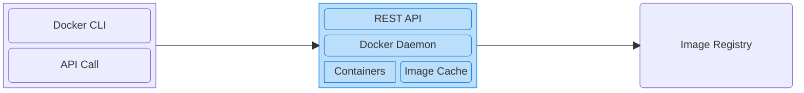

# Docker Fundamentals - Understanding Containers and Images  <!-- omit in toc -->

This repository is a structured, comprehensive collection of notes designed based on the [Docker Fundamentals - Understanding Containers and Images](https://www.coursera.org/learn/packt-docker-fundamentals-understanding-containers-and-images-pxlac) course offered on Coursera.

- [Introduction to Containers](#introduction-to-containers)
  - [Introduction](#introduction)
  - [Virtualization and Containerization Structure](#virtualization-and-containerization-structure)
  - [Virtual Machines vs. Docker Containers](#virtual-machines-vs-docker-containers)
  - [Docker Architecture](#docker-architecture)
- [Running Containers Using Docker](#running-containers-using-docker)
  - [Running Your First Container](#running-your-first-container)
  - [Container Lifecyle](#container-lifecyle)
  - [Build Your First Docker Image](#build-your-first-docker-image)
  - [Mounting a Local Directory](#mounting-a-local-directory)
- [Docker Compose](#docker-compose)
  - [Why Do We Need Docker Compose?](#why-do-we-need-docker-compose)
  - [Build Your First Compose Project](#build-your-first-compose-project)
  - [Dockerfile vs. Compose file](#dockerfile-vs-compose-file)
- [Introduction to Docker Images](#introduction-to-docker-images)
  - [What are Docker Images?](#what-are-docker-images)
- [Reference](#reference)


## Introduction to Containers

### Introduction
- A **container** is an **isolated, lightweight environment** for running **an application** and **its dependencies.**

  Containers encapsulate all the dependencies and configuration necessary to run whatever application. From the outside, they all look the same and are run almost the same way.
- **Container vs. Image:**
  - Image is a **blueprint/template**.
  - Container is a **running instance** created **from an image.**
- The **main benifit of containers** is that they let us **package an application** together **with its dependencies** in an **standardized, isolated environment,** so it can **run consistently** in **different environments.**
  - **Consistent environments:** Because containers encapsulate all the dependencies in an image. It **doesn't matter** how many times we use that image to create new containers, they will look exactly the same because they will follow the same set of instructions.
  - **Isolation:** containers of different applications can **run independently** on the same host. We **don't need** to install **all these environments** directly on the host.
  - Containers are **lightweight:** compared with VMs (virtual machines), containers **don't need a complete guest OS** (operating
  system). Containers **share the host kernel,** they generally:
    - use **fewer resources**,
    - **start** much faster, and
    - allow **more workloads** to run on the same machine. **(more efficiency)**

  - **Easy deployment:** Once **we've built** an image, we **can deploy** it elsewhere. This makes deployment **more predictable.**
  - **Easy scaling:** If our application **suddenly receives** a lot of traffic, we **can run** multiple instances. This is one reason containers are **important** for **microservices** and **cloud deployments.**
- A container **gives** an application a **standardized, isolated environment** so that we can **build it once** and **run it consistently** in different environments.

### Virtualization and Containerization Structure
- **Virtulization structure:**
  - **Virtual machine (VM):** each VM has it own guest OS. When we have virtualization, we do have two OS: host OS and the guest OS.
  - **Hypervisor** enables us to run virtual machines side by side. Hypervisor acts as a **layer of abstraction** and **translates** the instructions that are comming from the virtual machine OS **into** instructions that the host OS understands.

  ```mermaid
  block
    classDef default fill:#ECECFF, stroke:#9370DB;
    classDef blue fill:#bbdefb, stroke:#1e88e5;

    columns 1
    block:Virtualization
      columns 2
      block:VM_1
        columns 1
        App_1("Application")
        OS_1("Guest OS")
      end
      block:VM_2
        columns 1
        App_2("Application")
        OS_2("Guest OS")
      end
      Hypervisor["Hypervisor"]:2
      Host_OS["Host Operating System"]:2
      Hardware["Hardware Infrastructure"]:2

      class VM_1,VM_2 blue
    end
  ```
- **Containerization structure:**
  - **Container Engine:** is responsible for **managing containers.** Only application and its dependencies are packaged inside a container. Because there's no additional OS running inside of the containers, this contributes to having faster and leaner containers.

  ```mermaid
  block
    classDef default fill:#ECECFF, stroke:#9370DB;
    classDef blue fill:#bbdefb, stroke:#1e88e5;

    columns 1

    block:Containerization
      columns 2

      block:Container_1
        columns 1
        App_1("Application")
      end
      block:Container_2
        columns 1
        App_2("Application")
      end
      CE["Container Engine"]:2
      Host_OS["Host Operating System"]:2
      Hardware["Hardware Infrastructure"]:2

      class Container_1,Container_2 blue
    end
  ```

### Virtual Machines vs. Docker Containers
- **Isolation:**
  - **Virtual Machines** (VMs) provide a **stronger isolation** since each VM has its own OS, they are completely isolated from each other.
  - **Containers** provide **process-level isolation.** Containers share the host OS kernel, but they're running in isolation of each other. This isolation is managed by the container engine.
- **Size/Overhead:**
  - **VMs** have a **larger footprint** due to the guest OS and virtual hardware.
  - **Containers** are considerably **more lightweight** since they have minimal overhead.
- **Portability:**
  - **VMs** are **less portable** than containers because they might be tied to specific hypervisors or some configuration in the OS.
  - **Containers** are really **fully portable.** Containers should be platform-agnostic. If they're not platform-agnostic, they're not well-designed.
- **Use cases:**
  - **VMs** should **be recommended if:**
    - we need a **strong isolation** between different environments.
    - we're dealing with **legacy applications** that might not be easily containerized.
    - we want to **replicate a complete system environment** for testing or development.
  - We should **focus on containers if:**
    - we're **building modern, cloud-native** applications using **microservices architecture.**
    - we **need to scale** our application quickly and efficiently.
    - **portability** across different environments **is a top priority.**

### Docker Architecture

- **Docker Client:**
  - **Docker CLI:** the **command-line interface** to **interact with Docker.** It doesn't directly create containers. It **sends requests** to the Docker host through the REST API.
  - **API Call:** The Docker CLI **translates** a command into a request to the Docker API.
- **Docker Host:**
  - **REST API:** The **interface** through which the Docker client **communicates with** the Docker Daemon. It defines operations such as: create container, start container, stop container, pull image, list containers, etc.
  - **Docker Daemon:** The **main Docker service/process** that does the **actual work** on the Docker host. It **receives** API requests and **manages** containers, images, networks, volumes. The daemon is commonly the `dockerd` process.
  - **Containers:** the **actual running application environments** managed by Docker. A container is **created from** an image. **It's an instance** of an image.
  - **Image Cache:** contains **local images.** Docker can create containers from them **without downloading** them again. If an image isn't available locally (*in the image cache*), Docker can pull it from a registry.
- **Image Registry:** a server that **stores and distributes** Docker images. The most famous example is [Docker Hub](https://hub.docker.com).

**Common use cases:**
- **Running** a container from an image:
  1. **Docker CLI** issue `docker run` in the CLI.
  2. The command will be translated into a **REST API call** and be sent to **Docker host.**
  3. Once the Docker host receives this API request, it gonna look in the **Image Cache:** is this image provided in the Docker run command available in the local cache?
     - If the image **is not available in the local cache,** the Docker is gonna reach out to the **Image Registry**. It's gonna **download** this image **from the Image Registry.**
  4. If the image **is ready cached, Docker Daemon** will **initiate a new container** based on the image.
- **Building** an image:
  1. **Docker CLI** issue `docker build` in the CLI.
  2. The CLI will **translate into the relevant API request,** which is sent to the **Docker host.** This also **included** the respective **Dockerfile** and context.
  3. **Docker Daemon** builds the image according to the **Dockerfile.** Docker Daemon **may** reach out the **Image Registry** to **download any base images** that are mentioned in the Dockerfile.
  4. **Once the image** is built, Docker host **tags** the image and **stores** it **locally.**
- **Pushing** an image:
  1. Docker CLI issue `docker push` command on the CLI to upload a local image from **Image Cache** to the **Image Registry.**
  2. Docker host **must be correctly authenticated** into the **Image Registry** so that the image is pushed correctly.
     - If we're **using a private** Image Registry, Docker host **must also be** authenticated to **be able to download** images.
     - If we're **using a public one,** *for example,* [Docker Hub](https://hub.docker.com), we **don't need** to authenticate **to download** public images.
     - Nonetheless, **whenever** we want to **push or publish** something to the Image Registry, we do **need to be authenticated.**


## Running Containers Using Docker

### Running Your First Container
- **Pull** an image from **Image Registry** to **Image Cache:** `docker pull [image_name:tag]`. If we **omit** the tag, it **defaults to** the `latest` tag.

  *For example:* `docker pull nginx`.
- **List images** stored locally (in Image Cache): `docker images`.
- **Remove a local image:** `docker image rm [image_name:tag]`.

  *For example:* `docker image rm nginx:stable-trixie-perl`
- **Run** an image: `docker run [image_name:tag]`. This command will **create a new** container **and start** it. If we **omit** the tag, it **defaults to** the `latest` tag.

  *For example:* `docker run nginx`.
  - **Run** an image **in detached mode** by using the flag `-d`: `docker run -d [image_name:tag]`.

    *For example:* `docker run -d nginx`.

    In detached mode, Docker **runs the container in the background** without attaching the terminal to its output.

    **In practice,** we often use this flag **to free up** the terminal and **continue running** silently.
  - **Assign a custom name** to a container by using the flag `--name [custom_name]`.

    *For example:* `docker run --name web_server nginx`.

    This flag is **useful** because:
    - **without** `--name`, Docker generates a name **automatically**, such as `great_lichterman`.
    - **with** `--name`, we **choose a meaningful name.** It makes containers easier to identify and manage.

    Container names are **often used** in commands like `docker logs`, `docker stop`, `docker start`, `docker kill`, and `docker rm` instead of referring to container IDs.
  - **Map a port** on local computer to a port inside the container by using the flag `-p [port_on_computer]:[port_inside_container]`.

    *For example:* `docker run -p 8080:80 nginx` maps port 8080 on local computer to port 80 inside the container.
- **List running** Docker containers: `docker ps`.
  - `ps` stands for **Process Status** in Unix/Linux.
  - List all containers, **including stopped** ones: `docker ps -a`.
  - List **only stopped** containers: `docker ps -a --filter "status=exited"`.
  - Display **only** container IDs: `docker ps -q`. This **is useful when** passed into a subcommand. *For example,* to **stop all running** containers: `docker stop $(docker ps -q)`.
- **Stop a container:** `docker stop [container_name]` or `docker kill [container_name]`. Both these two commands stop the container. The **main difference** is **how the container is stopped.**
  - `docker kill`: **Immediately** sends a signal to stop the container, by defaul `SIGKILL`. The **danger** here is that we might **lose some content** that is in memory and the process, the container **doesn't have time** to persist this content to disk.
  - `docker stop`: **gracefully stops** the container, **giving** the application time to shut down. Docker **sends** `SIGTERM` to the container's main process **and waits for a grace period** (10 seconds by default on Linux containers). If the process hasn't stopped by then, Docker send `SIGKILL`. This gives the application a chance to:
    - finish ongoing work,
    - close database connections,
    - save data and clean up resources.
  - **Rule of thumb:**
    - use `docker stop` for normal operations.
    - use `docker kill` when we need to terminate a container immediately.
- **Remove a container:**
  - remove a **stopped container:** `docker rm [container_name]`.
  - list **only stopped** containers: `docker ps -a --filter "status=exited"`.
  - **force-remove** a container, stopping it if necessary: `docker rm -f [container_name]`.
  - **remove all stopped** containers after confirmation: `docker container prune`.

  It's a **good practice** to **clean up containers** that is **no longer used.**
  - **Organization:** avoid accumulating lots of old containers.
  - **Disk space:** containers can store writable-layer data and logs that consume disk space.
  - **Avoid name conflicts:** a stopped container still reserves its name, so we can't reuse that name until we remove it.

### Container Lifecyle
1. **Initializing** a container
   - **Create** a container: `docker create --name [container_name] [image_name:tag]`. The container **is created** but is **not running** yet.

      *For example:* `docker create --name web_server -p 8080:80 nginx`.
   - **Start** a container: `docker start [container_name]`.

      *For example:* `docker start web_server`.
   - **Create and start** a container: `docker run -d --name [container_name] [image_name:tag]`.

      *For example:* `docker run -d --name web_server -p 8080:80 nginx`.
2. Container **running**
   - **Display the logs** produced by a container: `docker logs [container_name]`. It's **often used when** a container fails to start properly or an application reports errors.

      *For example:* `docker logs web_server`.

      **Useful flags:**
      - `-f` (`--follow`): **continuously displays** new log output, like **watching a live log.**

        *For example:* `docker logs -f web_server`.
      - `--tail`: **displays the last** `n` lines.

        *For example:* `docker logs --tail 100 web_server`.
   - **Display detailed configuration** and **state information** about a **container or image** in JSON format: `docker inspect [container_name] / [image_name:tag]`. This command is **often used when** we need to check a container's status, IP address, port mappings, environment variables, etc.

      *For example:* `docker inspect web_server`, `docker inspect nginx:latest`.

      We can **inspect specific properties** using the flag `--format`. *For example:*

      `docker inspect --format "{{.State.Status}}" web_server`.

      `docker inspect --format "{{json .NetworkSettings.Ports}}" web_server`.
    - **Execute** a command **inside** an **already-running** container, **without** creating another container: `docker exec [container_name] [command]`. It is **often used when** we want to inspect files, check processes, or execute diagnostic commands **inside a running** container.

      *For example:* `docker exec web_server nginx -v`.

      `docker exec -it web_server bash`: **open a shell** inside the `web_server` Nginx container.
      - `-i`: **keep standard input** open.
      - `-t`: **allocate** a terminal.
      - `bash`: the shell to run inside the container.
    - **Freeze** a container: `docker pause [container_name]`.

      *For example:* `docker pause web_server`.

      Docker **suspends all processes** in the container. They **stop executing until** the container is unpaused.
      - The container still exists. Its **status becomes** `Paused`.
      - Its configuration and filesystem **remain intact.**
    - **Resume** a container: `docker unpause [container_name]`.

      *For example:* `docker unpause web_server`.

      Docker **resumes the paused** processes. They **continue from** where they were suspended, rather than starting over.
    - **Stop** a container:
      - **Gracefully** stop the main process: `docker stop [container_name]`.
      - **Forcefully** stop the main process: `docker kill [container_name]`.

      The main process might **exit with** either a **zero code** or with a **non-zero** code.
      - `exit 0` means everything **ok.**
      - `exit <non-zero>` means **an error occured.**
3. Container **stopped**

    If a container is stopped, it's in the **stopped phase.** The container **still exists** and **can be seen** with `docker ps -a`.

    We can also **inspect the logs** of the container `docker logs [container_name]` and **inspect the container** itself `docker inspect [container_name]`.
4. Container **removed**

   `docker rm [container_name]` removes a **stopped container.** It compeletely does some **cleanup and free up** resources. The **container and its contents** are **removed, not available** anymore.

5. **Restart policy**

   A restart policy **defines** whether Docker **should automatically restart** a container **when** it exits **or when** Docker restarts.

   There're **four restart policies:**
   - `no`: Never automatically restart the container. This **is the default.**
   - `on-failure`: Restart **if** the container **exits with** a **non-zero** exit code.
   - `always`: Always restart the container **if** it stops, and restart it **when** the Docker daemon starts again, **subject to** Docker's restart rules.
   - `unless-stopped`: **like** `always`, but a container **manually stopped** by you **remains stopped when** the Docker daemon restarts.

   **Useful commands:**
   - **Define** the restart policy by using the `--restart` flag **when creating** a container **from** an image. *For example:*

      ```cmd
      # use no restart policy
      docker run -d --name web_server nginx

      # use on-failure restart policy
      docker run -d --name web_server --restart on-failure:5 nginx

      # use always restart policy
      docker run -d --name web_server --restart always nginx

      # use unless-stopped restart policy
      docker run -d --name web_server --restart unless-stopped nginx
      ```
      `on-failure:5` defines that Docker **retries** the container **up to five times** if its main process **exits with** a **non-zero** code.
   - **Check the configured** restart policy of a container by using the `--format` flag of the `docker inspect` command. *For example:*

      ```cmd
      docker inspect --format "{{.HostConfig.RestartPolicy}} web_server"
      ```
   - **Update the configured** restart policy of a container by using the `--restart` flag of the `docker update` command. *For example:*

      ```cmd
      docker update --restart always web_server
      ```

### Build Your First Docker Image

1. **Create a project directory**

   ```cmd
   mkdir hello-docker
   cd hello-docker
   ```
   The project directory will contain two files:

   ```text
    hello-docker/
    │
    ├── app.py  # Python application
    └── Dockerfile  # Image instructions
    ```
2. **Create the Python application**

    Create a file named `app.py` with this content.

    ```python
    print("Hello from Docker!")
    ```
    This is the application that our container will execute.
3. **Create the Dockerfile**

   Create another file named `Dockerfile`, **without a file extension,** with this content.

   ```dockerfile
   # Start from an official Python image
   FROM python:3.12-slim

   # Set the working directory in the container
   WORKDIR /app

   # Copy the application files to the container
   COPY app.py .

   # Run the application when the container starts
   CMD ["python", "app.py"]
   ```
   Here's what each instruction does:
   - **FROM:** specifies the **base image,** which provides Python.
   - **WORKDIR:** sets `/app` as the **working directory inside** the image.

      `/app` is a **common convention for** application files. Docker **creates** `/app` if it **doesn't exist,** then set it as the working directory.
   - **COPY:** copies `app.py` from the project directory **into the working directory** in the image.
   - **CMD:** specifies the **default command to execute** when a container starts.

4. **Build the Docker image**

   From **inside the project directory** `hello-docker`, run `docker build`.

   ```cmd
   docker build -t hello-docker:latest .
   ```
   Let's break down the command.
   - `docker build`: builds an **image from** a Dockerfile.
   - `-t hello-docker:latest`: **names** the image `hello-docker` and **assigns** it the **tag** `latest`.
   - `.`: uses the current directory as the **build context,** the set of files Docker can access for instructions such as `COPY`.

      Docker **will download** the Python base image **if** it **isn't already available** locally, the execute the `Dockerfile` instructions.
5. **Check the image**

   Run the command `docker images` to verify that the image `hello-docker:1.0` in the list of images.
6. **Run a container** from the created image

   Run a container from the image that we've just created to confirm that it prints `Hello from Docker!`.
   ```cmd
   docker run --name hello_docker hello-docker:1.0
   ```

### Mounting a Local Directory
- There're two approaches to mount a directory on host computer into a Docker container, using `-v` (Docker volume) or `--mount` (Bind mount) with `docker run`.
  - Using **Docker volume:** `docker run -v [path_to_host_dir]:[path_to_container_dir] [image_name:tag]`. *For example:*

    ```cmd
    docker run -d --name web_server -p 80:80 -v "${PWD}\site:/usr/share/nginx/html" nginx
    ```
    - `PWD`: stands for **Print Working Directory.**
    - `$PWD`: **access** the automatic variable directly.
    - `${PWD}`: **access** the variable using braces. It **is useful when** the variable name touches other characters.
    - `$(...)`: **evaluate** an expression **and substitute** its result as a string. *For example:* `$(docker ps -q)`.
  - Using **bind mount:** `docker run --mount "type=bind,source=[path_to_host_dir],target=[path_to_container_dir]" [image_name:tag]`. *For example:*

    ```cmd
    docker run --rm -it --mount "type=bind,source=${PWD}\hello-docker,target=/app" python:3.12-slim bash
    ```
    - `--rm`: **Removes** the container **when it exits.** This is useful for testing.
    - `-it`: Opens an **interactive terminal.**

    We **can set** the directory **to** `read-only` on the host container by adding the `readonly` attribute, like this, `docker run --mount "type=bind,source=[path_to_host_dir],target=[path_to_container_dir],readonly" [image_name:tag]`. This **is useful for** configuration files, datasets, and other files the container shouldn't change.

- **Difference:**
  - With **bind mount,** Docker normally **reports an error if** the source path **doesn't exist.**
  - The **Docker volume can create a missing host directory** automatically.
- **Rule of thumb:**
  - Use a **bind mount when** we want a container to **access a particular** local directory.
  - Use a **volume when** Docker should **manage** persistent data **independently** of the project data.
- **Like port mapping,** we **can't change or update** a volume or a bind mount once a container is created. It must be configured when creating the container with `docker run`.


## Docker Compose
- Docker Compose is a **tool for defining and running** multi-container applications **using a configuration file.**
- Instead of **manually creating containers** with long `docker run` commands, we **describe the setup once** in a `compose.yaml` file, and Docker Compose handles the creation and startup.

### Why Do We Need Docker Compose?
Imagine our application **consists of two services:**
- A Python web application.
- An Nginx web server.

**Without** Docker Compose, we might run separate commands to build images, create containers, configure ports, set up mounts, and start services. We'd need to remember all those options.

**With** Docker Compose, we describe the setup in one file `compose.yaml`, then Docker Compose creates and manages the containers and their networking based on the file.

Key **benefits over manually** management containers is file-based configuration, reproducible setups, and centralized updates.

### Build Your First Compose Project
1. **Check Docker Compose:** `docker compose version`
2. **Create the project:**

   ```cmd
   mkdir compose-nginx
   cp -r site compose-nginx
   cd compose-nginx
   ```
   The structure of the `compose-nginx` directory shkould now look like this:

   ```text
   compose-nginx/
    │
    ├── site/
    └──── index.html
   ```
3. **Create** `compose.yaml`: create a file named `compose.yaml` in the `compose-nginx` directory with the content below.

    This Compose project provides two services:
    - a Python application from the `hello-docker:latest` image, built in [Build Your First Docker Image](#build-your-first-docker-image).
    - an Nginx webserver.

    ```yaml
    services:
      web:
        image: nginx:latest
        ports:
          - "80:80"
        volumes:
          - type: bind
            source: ./site
            target: /usr/share/nginx/html
            read_only: true
      python-app:
        image: hello-docker:latest
    ```
   - `services`: defines the services in our application.
   - `web`, `python-app`: the name of services. **We choose it.**
   - `image`: uses the `nginx:latest` and `hello-docker:latest` image.
   - `ports`: maps host port `80` to the container port `80`.
   - `volumes`: mounts the local `site` directory into the container.
   - `read_only: true`: prevents the container from modifying the mounted files.
   - The `source: ./site` path **is relative to** the Compose file's directory.
4. **Start** the application: run the command `docker compose up -d` from the **directory containing** `compose.yaml`.
5. **Manage** the application: Here are the primary commands for managing the application:
   - `docker compose ps`: list the project's containers and their status.
   - `docker compose logs`: view the service logs. *For examples:* to view output from the Python app:

      ```cmd
      docker compose logs python-app
      ```
      Compose **determines** which **project to target** from the **current directory,** the Compose file options, and potentially the project name. It means that `docker compose logs` **displays only** logs of the project in current directory.
   - `docker compose stop`: stop the services without removing their containers.
   - `docker compose start`: start previously stopped containers.
   - `docker compose down`: **stop and remove** the project's containers and default network.

### Dockerfile vs. Compose file
| `Dockerfile`                                                 | `compose.yaml`                             |
|--------------------------------------------------------------|--------------------------------------------|
| Defines how to build an image.                               | Defines how to configure and run services. |
| Specifies the base image, copied files, and startup command. | Specifies images, ports, volumnes, networks, and other runtime settings. |
| Used by `docker build`.                                      | Used by `docker compose up`.               |

For a Python application, we can **use both:**
- the `Dockerfile` builds our Python images,
- the `compose.yaml` defines how to run the Python service alongside a database or other services.


## Introduction to Docker Images

### What are Docker Images?
- We can think about Docker images as the **DNA of containers.**
- Basically, they're **blueprints** that's gonna be used by Docker **to create** new containers. Every container that is created based on an image will have the exact same shape at the beginning of that container lifetime.
- Images are **self-contained,** read-only template that **encapsulates everything needed** to run our application. They often contain:
  ```mermaid
  block
    classDef default fill:#ECECFF, stroke:#9370DB;
    columns 1

    block:Image
      columns 1
      Configuration
      App["Application Code"]
      Dependencies
      RuntimeEnv["Runtime Environemnt"]
      BaseImage["Base Layer"]

      class Container_1,Container_2 blue
    end
  ```
  - **The base layer:** often a minimal Linux distribution like Alpine, or a more full-fledged one like Ubuntu.
  - **Runtime enivronment:** specific software (e.g., Python, Node.js) required by the application.
  - **Libraries and dependencies:** all the external code that the application relies on.
  - **Application code:** The application source code or its compiled binaries.
  - **Configuration:** settings for the application and its environment. **Configuration might be** a little bit **trickier to package inside** of the image because **it varies very often** depending on which environment we're running the containers on.
- A Docker image is **like a snapshot** of the **application and its complete runtime environment,** frozen in time and ready to be brought to life as a container.
- Images can be **sources from mulitple locations:**
  - [**Docker Hub**](https://hub.docker.com): official Docker image repository, **offering a vast collection** of images for various purposes.
  - **Private registries:** for organizations or individuals with proprietary software. Private registries **provide secure storage** for custom images.
  - **Building own images:** writting `Dockerfile`s creates images that perfectly match our application's requirements.


## Reference
1. [Docker Fundamentals - Understanding Containers and Images](https://www.coursera.org/learn/packt-docker-fundamentals-understanding-containers-and-images-pxlac)
2. ChatGPT