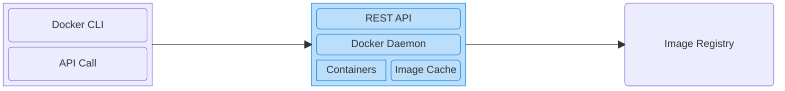

# Docker Fundamentals - Understanding Containers and Images  <!-- omit in toc -->

This repository is a structured, comprehensive collection of notes designed based on the [Docker Fundamentals - Understanding Containers and Images](https://www.coursera.org/learn/packt-docker-fundamentals-understanding-containers-and-images-pxlac) course offered on Coursera.

- [Introduction to Containers](#introduction-to-containers)
  - [Introduction](#introduction)
  - [Virtualization and Containerization Structure](#virtualization-and-containerization-structure)
  - [Virtual Machines vs. Docker Containers](#virtual-machines-vs-docker-containers)
  - [Docker Architecture](#docker-architecture)
- [Reference](#reference)


## Introduction to Containers

### Introduction
- A **container** is an **isolated, lightweight environment** for running **an application** and **its dependencies.**

  Containers encapsulate all the dependencies and configuration necessary to run whatever application. From the outside, they all look the same and are run almost the same way.
- **Container vs. Image:**
  - Image is a **blueprint/template**.
  - Container is a **running instance** created **from an image.**
- The **main benifit of containers** is that they let us **package an application** together **with its dependencies** in an **standardized, isolated environment,** so it can **run consistently** in **different environments.**
  - **Consistent environments:** Because containers encapsulate all the dependencies in an image. It **doesn't matter** how many times we use that image to create new containers, they will look exactly the same because they will follow the same set of instructions.
  - **Isolation:** containers of different applications can **run independently** on the same host. We **don't need** to install **all these environments** directly on the host.
  - Containers are **lightweight:** compared with VMs (virtual machines), containers **don't need a complete guest OS** (operating
  system). Containers **share the host kernel,** they generally:
    - use **fewer resources**,
    - **start** much faster, and
    - allow **more workloads** to run on the same machine. **(more efficiency)**

  - **Easy deployment:** Once **we've built** an image, we **can deploy** it elsewhere. This makes deployment **more predictable.**
  - **Easy scaling:** If our application **suddenly receives** a lot of traffic, we **can run** multiple instances. This is one reason containers are **important** for **microservices** and **cloud deployments.**
- A container **gives** an application a **standardized, isolated environment** so that we can **build it once** and **run it consistently** in different environments.

### Virtualization and Containerization Structure
- **Virtulization structure:**
  - **Virtual machine (VM):** each VM has it own guest OS. When we have virtualization, we do have two OS: host OS and the guest OS.
  - **Hypervisor** enables us to run virtual machines side by side. Hypervisor acts as a **layer of abstraction** and **translates** the instructions that are comming from the virtual machine OS **into** instructions that the host OS understands.

  ```mermaid
  block
    classDef default fill:#ECECFF, stroke:#9370DB;
    classDef blue fill:#bbdefb, stroke:#1e88e5;

    columns 1
    block:Virtualization
      columns 2
      block:VM_1
        columns 1
        App_1("Application")
        OS_1("Guest OS")
      end
      block:VM_2
        columns 1
        App_2("Application")
        OS_2("Guest OS")
      end
      Hypervisor["Hypervisor"]:2
      Host_OS["Host Operating System"]:2
      Hardware["Hardware Infrastructure"]:2

      class VM_1,VM_2 blue
    end
  ```
- **Containerization structure:**
  - **Container Engine:** is responsible for **managing containers.** Only application and its dependencies are packaged inside a container. Because there's no additional OS running inside of the containers, this contributes to having faster and leaner containers.

  ```mermaid
  block
    classDef default fill:#ECECFF, stroke:#9370DB;
    classDef blue fill:#bbdefb, stroke:#1e88e5;

    columns 1

    block:Containerization
      columns 2

      block:Container_1
        columns 1
        App_1("Application")
      end
      block:Container_2
        columns 1
        App_2("Application")
      end
      CE["Container Engine"]:2
      Host_OS["Host Operating System"]:2
      Hardware["Hardware Infrastructure"]:2

      class Container_1,Container_2 blue
    end
  ```
### Virtual Machines vs. Docker Containers
- **Isolation:**
  - **Virtual Machines** (VMs) provide a **stronger isolation** since each VM has its own OS, they are completely isolated from each other.
  - **Containers** provide **process-level isolation.** Containers share the host OS kernel, but they're running in isolation of each other. This isolation is managed by the container engine.
- **Size/Overhead:**
  - **VMs** have a **larger footprint** due to the guest OS and virtual hardware.
  - **Containers** are considerably **more lightweight** since they have minimal overhead.
- **Portability:**
  - **VMs** are **less portable** than containers because they might be tied to specific hypervisors or some configuration in the OS.
  - **Containers** are really **fully portable.** Containers should be platform-agnostic. If they're not platform-agnostic, they're not well-designed.
- **Use cases:**
  - **VMs** should **be recommended if:**
    - we need a **strong isolation** between different environments.
    - we're dealing with **legacy applications** that might not be easily containerized.
    - we want to **replicate a complete system environment** for testing or development.
  - We should **focus on containers if:**
    - we're **building modern, cloud-native** applications using **microservices architecture.**
    - we **need to scale** our application quickly and efficiently.
    - **portability** across different environments **is a top priority.**

### Docker Architecture


- **Docker Client:**
  - **Docker CLI:** the **command-line interface** to **interact with Docker.** It doesn't directly create containers. It **sends requests** to the Docker host through the REST API.
  - **API Call:** The Docker CLI **translates** a command into a request to the Docker API.
- **Docker Host:**
  - **REST API:** The **interface** through which the Docker client **communicates with** the Docker Daemon. It defines operations such as: create container, start container, stop container, pull image, list containers, etc.
  - **Docker Daemon:** The **main Docker service/process** that does the **actual work** on the Docker host. It **receives** API requests and **manages** containers, images, networks, volumnes. The daemon is commonly the `dockerd` process.
  - **Containers:** the **actual running application environments** managed by Docker. A container is **created from** an image. **It's an instance** of an image.
  - **Image Cache:** contains **local images.** Docker can create containers from them **without downloading** them again. If an image isn't available locally (*in the image cache*), Docker can pull it from a registry.
- **Image Registry:** a server that **stores and distributes** Docker images. The most famous example is [Docker Hub](https://hub.docker.com).

**Common use cases:**
- **Running** a container from an image:
  1. **Docker CLI** issue `docker run` in the CLI.
  2. The command will be translated into a **REST API call** and be sent to **Docker host.**
  3. Once the Docker host receives this API request, it gonna look in the **Image Cache:** is this image provided in the Docker run command available in the local cache?
     - If the image **is not available in the local cache,** the Docker is gonna reach out to the **Image Registry**. It's gonna **download** this image **from the Image Registry.**
  4. If the image **is ready cached, Docker Daemon** will **initiate a new container** based on the image.
- **Building** an image:
  1. **Docker CLI** issue `docker build` in the CLI.
  2. The CLI will **translate into the relevant API request,** which is sent to the **Docker host.** This also **included** the respective **Dockerfile** and context.
  3. **Docker Daemon** builds the image according to the **Dockerfile.** Docker Daemon **may** reach out the **Image Registry** to **download any base images** that are mentioned in the Dockerfile.
  4. **Once the image** is built, Docker host **tags** the image and **stores** it **locally.**
- **Pushing** an image:
  1. Docker CLI issue `docker push` command on the CLI to upload a local image from **Image Cache** to the **Image Registry.**
  2. Docker host **must be correctly authenticated** into the **Image Registry** so that the image is pushed correctly.
     - If we're **using a private** Image Registry, Docker host **must also be** authenticated to **be able to download** images.
     - If we're **using a public one,** *for example,* [Docker Hub](https://hub.docker.com), we **don't need** to authenticate **to download** public images.
     - Nonetheless, **whenever** we want to **push or publish** something to the Image Registry, we do **need to be authenticated.**


## Reference
1. [Docker Fundamentals - Understanding Containers and Images](https://www.coursera.org/learn/packt-docker-fundamentals-understanding-containers-and-images-pxlac)
2. ChatGPT