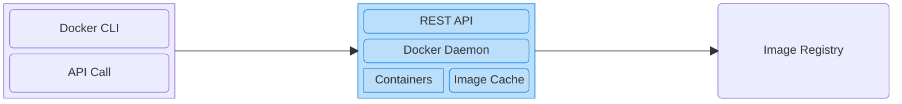

# Docker Fundamentals - Understanding Containers and Images  <!-- omit in toc -->

This repository is a structured, comprehensive collection of notes designed based on the [Docker Fundamentals - Understanding Containers and Images](https://www.coursera.org/learn/packt-docker-fundamentals-understanding-containers-and-images-pxlac) course offered on Coursera.

- [Introduction to Containers](#introduction-to-containers)
  - [Introduction](#introduction)
  - [Virtualization and Containerization Structure](#virtualization-and-containerization-structure)
  - [Virtual Machines vs. Docker Containers](#virtual-machines-vs-docker-containers)
  - [Docker Architecture](#docker-architecture)
- [Running Containers Using Docker](#running-containers-using-docker)
  - [Running Your First Container](#running-your-first-container)
  - [Container Lifecyle](#container-lifecyle)
  - [Build Your First Docker Image](#build-your-first-docker-image)
  - [Mounting a Local Directory](#mounting-a-local-directory)
- [Docker Compose](#docker-compose)
  - [Why Do We Need Docker Compose?](#why-do-we-need-docker-compose)
  - [Build Your First Compose Project](#build-your-first-compose-project)
  - [Dockerfile vs. Compose file](#dockerfile-vs-compose-file)
- [Introduction to Docker Images](#introduction-to-docker-images)
  - [What are Docker Images?](#what-are-docker-images)
  - [Container Registries](#container-registries)
  - [Importance of Versioning](#importance-of-versioning)
  - [Managing Docker Images](#managing-docker-images)
  - [Introduction to Dockerfiles](#introduction-to-dockerfiles)
  - [Docker Image Layers](#docker-image-layers)
- [Containerize an Express App](#containerize-an-express-app)
  - [Building an Express App](#building-an-express-app)
  - [`npm` Scripts](#npm-scripts)
  - [Test the Users App](#test-the-users-app)
  - [Dockerizing the Users App](#dockerizing-the-users-app)
- [In-Depth Look at Docker Images](#in-depth-look-at-docker-images)
  - [Exploring Build Contexts](#exploring-build-contexts)
  - [Introduction to Environment Variables](#introduction-to-environment-variables)
  - [`CMD` vs. `ENTRYPOINT`](#cmd-vs-entrypoint)
  - [Introduction to Distroless Images](#introduction-to-distroless-images)
  - [Introduction to Multi-stage Dockerfiles](#introduction-to-multi-stage-dockerfiles)
  - [Adding TypeScript to The Express App](#adding-typescript-to-the-express-app)
- [Reference](#reference)


## Introduction to Containers

### Introduction
- A **container** is an **isolated, lightweight environment** for running **an application** and **its dependencies.**

  Containers encapsulate all the dependencies and configuration necessary to run whatever application. From the outside, they all look the same and are run almost the same way.
- **Container vs. Image:**
  - Image is a **blueprint/template**.
  - Container is a **running instance** created **from an image.**
- The **main benifit of containers** is that they let us **package an application** together **with its dependencies** in an **standardized, isolated environment,** so it can **run consistently** in **different environments.**
  - **Consistent environments:** Because containers encapsulate all the dependencies in an image. It **doesn't matter** how many times we use that image to create new containers, they will look exactly the same because they will follow the same set of instructions.
  - **Isolation:** containers of different applications can **run independently** on the same host. We **don't need** to install **all these environments** directly on the host.
  - Containers are **lightweight:** compared with VMs (virtual machines), containers **don't need a complete guest OS** (operating
  system). Containers **share the host kernel,** they generally:
    - use **fewer resources**,
    - **start** much faster, and
    - allow **more workloads** to run on the same machine. **(more efficiency)**

  - **Easy deployment:** Once **we've built** an image, we **can deploy** it elsewhere. This makes deployment **more predictable.**
  - **Easy scaling:** If our application **suddenly receives** a lot of traffic, we **can run** multiple instances. This is one reason containers are **important** for **microservices** and **cloud deployments.**
- A container **gives** an application a **standardized, isolated environment** so that we can **build it once** and **run it consistently** in different environments.

### Virtualization and Containerization Structure
- **Virtulization structure:**
  - **Virtual machine (VM):** each VM has it own guest OS. When we have virtualization, we do have two OS: host OS and the guest OS.
  - **Hypervisor** enables us to run virtual machines side by side. Hypervisor acts as a **layer of abstraction** and **translates** the instructions that are comming from the virtual machine OS **into** instructions that the host OS understands.

  ```mermaid
  block
    classDef default fill:#ECECFF, stroke:#9370DB;
    classDef blue fill:#bbdefb, stroke:#1e88e5;

    columns 1
    block:Virtualization
      columns 2
      block:VM_1
        columns 1
        App_1("Application")
        OS_1("Guest OS")
      end
      block:VM_2
        columns 1
        App_2("Application")
        OS_2("Guest OS")
      end
      Hypervisor["Hypervisor"]:2
      Host_OS["Host Operating System"]:2
      Hardware["Hardware Infrastructure"]:2

      class VM_1,VM_2 blue
    end
  ```
- **Containerization structure:**
  - **Container Engine:** is responsible for **managing containers.** Only application and its dependencies are packaged inside a container. Because there's no additional OS running inside of the containers, this contributes to having faster and leaner containers.

  ```mermaid
  block
    classDef default fill:#ECECFF, stroke:#9370DB;
    classDef blue fill:#bbdefb, stroke:#1e88e5;

    columns 1

    block:Containerization
      columns 2

      block:Container_1
        columns 1
        App_1("Application")
      end
      block:Container_2
        columns 1
        App_2("Application")
      end
      CE["Container Engine"]:2
      Host_OS["Host Operating System"]:2
      Hardware["Hardware Infrastructure"]:2

      class Container_1,Container_2 blue
    end
  ```

### Virtual Machines vs. Docker Containers
- **Isolation:**
  - **Virtual Machines** (VMs) provide a **stronger isolation** since each VM has its own OS, they are completely isolated from each other.
  - **Containers** provide **process-level isolation.** Containers share the host OS kernel, but they're running in isolation of each other. This isolation is managed by the container engine.
- **Size/Overhead:**
  - **VMs** have a **larger footprint** due to the guest OS and virtual hardware.
  - **Containers** are considerably **more lightweight** since they have minimal overhead.
- **Portability:**
  - **VMs** are **less portable** than containers because they might be tied to specific hypervisors or some configuration in the OS.
  - **Containers** are really **fully portable.** Containers should be platform-agnostic. If they're not platform-agnostic, they're not well-designed.
- **Use cases:**
  - **VMs** should **be recommended if:**
    - we need a **strong isolation** between different environments.
    - we're dealing with **legacy applications** that might not be easily containerized.
    - we want to **replicate a complete system environment** for testing or development.
  - We should **focus on containers if:**
    - we're **building modern, cloud-native** applications using **microservices architecture.**
    - we **need to scale** our application quickly and efficiently.
    - **portability** across different environments **is a top priority.**

### Docker Architecture

- **Docker Client:**
  - **Docker CLI:** the **command-line interface** to **interact with Docker.** It doesn't directly create containers. It **sends requests** to the Docker host through the REST API.
  - **API Call:** The Docker CLI **translates** a command into a request to the Docker API.
- **Docker Host:**
  - **REST API:** The **interface** through which the Docker client **communicates with** the Docker Daemon. It defines operations such as: create container, start container, stop container, pull image, list containers, etc.
  - **Docker Daemon:** The **main Docker service/process** that does the **actual work** on the Docker host. It **receives** API requests and **manages** containers, images, networks, volumes. The daemon is commonly the `dockerd` process.
  - **Containers:** the **actual running application environments** managed by Docker. A container is **created from** an image. **It's an instance** of an image.
  - **Image Cache:** contains **local images.** Docker can create containers from them **without downloading** them again. If an image isn't available locally (*in the image cache*), Docker can pull it from a registry.
- **Image Registry:** a server that **stores and distributes** Docker images. The most famous example is [Docker Hub](https://hub.docker.com).

**Common use cases:**
- **Running** a container from an image:
  1. **Docker CLI** issue `docker run` in the CLI.
  2. The command will be translated into a **REST API call** and be sent to **Docker host.**
  3. Once the Docker host receives this API request, it gonna look in the **Image Cache:** is this image provided in the Docker run command available in the local cache?
     - If the image **is not available in the local cache,** the Docker is gonna reach out to the **Image Registry**. It's gonna **download** this image **from the Image Registry.**
  4. If the image **is ready cached, Docker Daemon** will **initiate a new container** based on the image.
- **Building** an image:
  1. **Docker CLI** issue `docker build` in the CLI.
  2. The CLI will **translate into the relevant API request,** which is sent to the **Docker host.** This also **included** the respective **Dockerfile** and context.
  3. **Docker Daemon** builds the image according to the **Dockerfile.** Docker Daemon **may** reach out the **Image Registry** to **download any base images** that are mentioned in the Dockerfile.
  4. **Once the image** is built, Docker host **tags** the image and **stores** it **locally.**
- **Pushing** an image:
  1. Docker CLI issue `docker push` command on the CLI to upload a local image from **Image Cache** to the **Image Registry.**
  2. Docker host **must be correctly authenticated** into the **Image Registry** so that the image is pushed correctly.
     - If we're **using a private** Image Registry, Docker host **must also be** authenticated to **be able to download** images.
     - If we're **using a public one,** *for example,* [Docker Hub](https://hub.docker.com), we **don't need** to authenticate **to download** public images.
     - Nonetheless, **whenever** we want to **push or publish** something to the Image Registry, we do **need to be authenticated.**


## Running Containers Using Docker

### Running Your First Container
- **Pull** an image from **Image Registry** to **Image Cache:** `docker pull [image_name:tag]`. *For example:*

  ```bash
  docker pull nginx
  ```
- **Important:** when **no image tag** is explicitly specified, Docker **defaults to** using `latest` automatically.
- **List images** stored locally (in Image Cache):

  ```bash
  docker images
  ```
- **Remove a local image:** `docker image rm [image_name:tag]`. *For example:*

  ```bash
  docker image rm nginx:stable-trixie-perl
  ```
- **Run** an image: `docker run [image_name:tag]`. This command will **create a new** container **and start** it. *For example:*

  ```bash
  docker run nginx
  ```
  - **Run** an image **in detached mode** by using the flag `-d`: `docker run -d [image_name:tag]`. *For example:*

    ```bash
    docker run -d nginx
    ```
    In detached mode, Docker **runs the container in the background** without attaching the terminal to its output. We **often use** this flag **to free up** the terminal and **continue running** silently.
  - **Assign a custom name** to a container by using the flag `--name [custom_name]`. *For example:*

    ```bash
    docker run --name web_server nginx
    ```
    This flag is **useful** because:
    - **without** `--name`, Docker generates a name **automatically**, such as `great_lichterman`.
    - **with** `--name`, we **choose a meaningful name.** It makes containers easier to identify and manage.

    Container names are **often used** in commands like `docker logs`, `docker stop`, `docker start`, `docker kill`, and `docker rm` instead of referring to container IDs.
  - **Map a port** on host computer to a port inside the container by using the flag `-p [port_on_computer]:[port_inside_container]`. *For example:* mapping port 8080 on host computer to port 80 inside the container.

    ```bash
    docker run -p 8080:80 nginx
    ```
- **List running** Docker containers:

  ```bash
  docker ps
  ```
  - `ps` stands for **Process Status** in Unix/Linux.
  - List all containers, **including stopped** ones:

    ```bash
    docker ps -a
    ```
  - List **only stopped** containers:

    ```bash
    docker ps -a --filter "status=exited"
    ```
  - Display **only** container IDs: `docker ps -q`.

    ```bash
    docker ps -q
    ```
    This **is useful when** passed into a subcommand. *For example,* to **stop all running** containers:

    ```bash
    docker stop $(docker ps -q)
    ```
- **Stop a container:** `docker stop [container_name]` or `docker kill [container_name]`. *For example:*

  ```bash
  docker stop web_server
  docker kill web_server
  ```
  Both those two commands stop the container. The **main difference** is **how the container is stopped.**
  - `docker kill`: **Immediately** sends a signal to stop the container, by defaul `SIGKILL`. The **danger** here is that we might **lose some content** that is in memory and the process, the container **doesn't have time** to persist this content to disk.
  - `docker stop`: **gracefully stops** the container, **giving** the application time to shut down. Docker **sends** `SIGTERM` to the container's main process **and waits for a grace period** (10 seconds by default on Linux containers). If the process hasn't stopped by then, Docker send `SIGKILL`. This gives the application a chance to:
    - finish ongoing work,
    - close database connections,
    - save data and clean up resources.
  - **Rule of thumb:**
    - use `docker stop` for normal operations.
    - use `docker kill` when we need to terminate a container immediately.
- **Remove a container:**
  - remove a **stopped container:** `docker rm [container_name]`. *For example:*

    ```bash
    docker rm web_server
    ```
  - list **only stopped** containers:

    ```bash
    docker ps -a --filter "status=exited"
    ```
  - **force-remove** a container, stopping it if necessary: `docker rm -f [container_name]`. *For example:*

    ```bash
    docker rm -f web_server
    ```
  - **remove all stopped** containers after confirmation:
    ```bash
    docker container prune
    ```
  It's a **good practice** to **clean up containers** that is **no longer used.**
  - **Organization:** avoid accumulating lots of old containers.
  - **Disk space:** containers can store writable-layer data and logs that consume disk space.
  - **Avoid name conflicts:** a stopped container still reserves its name, so we can't reuse that name until we remove it.

### Container Lifecyle
1. **Initializing** a container
   - **Create** a container from an image: `docker create --name [container_name] [image_name:tag]`. The container **is created** but is **not running** yet. *For example:*

      ```bash
      docker create --name web_server -p 8080:80 nginx
      ```
   - **Start** a container: `docker start [container_name]`. *For example:*

      ```bash
      docker start web_server
      ```
   - **Create and start** a container from an image: `docker run -d --name [container_name] [image_name:tag]`. *For example:*

      ```bash
      docker run -d --name web_server -p 8080:80 nginx
      ```
2. Container **running**
   - **Display the logs** produced by a container: `docker logs [container_name]`. It's **often used when** a container fails to start properly or an application reports errors. *For example:*

      ```bash
      docker logs webs_server
      ```
      **Useful flags:**
      - `-f` (`--follow`): **continuously displays** new log output, like **watching a live log.** *For example:*

        ```bash
        docker logs -f web_server
        ```
      - `--tail`: **displays the last** `n` lines. *For example:*

        ```bash
        docker logs --tail 20 web_server
        ```
   - **Display detailed configuration** and **state information** about a **container or image** in JSON format: `docker inspect [container_name] / [image_name:tag]`. This command is **often used when** we need to check a container's status, IP address, port mappings, environment variables, etc. *For example:*

      ```bash
      docker inspect web_server
      docker inspect nginx:latest
      ```
      We can **inspect specific properties** using the flag `--format`. *For example:*

      ```bash
      docker inspect --format "{{.State.Status}}" web_server
      docker inspect --format "{{json .NetworkSettings.Ports}}" web_server
      ```
    - **Execute** a command **inside** an **already-running** container, **without** creating another container: `docker exec [container_name] [command]`. It is **often used when** we want to inspect files, check processes, or execute diagnostic commands **inside a running** container. *For example:*

      ```bash
      docker exec web_server nginx -v
      ```
      Using flags `-it` to **open a shell** inside the `web_server` Nginx container **and keep** its standard **input open.**

      ```bash
      docker exec -it web_server bash
      ```
      - `-i`: **keep standard input** open.
      - `-t`: **allocate** a terminal.
      - `bash`: the shell to run inside the container.

        **Important:** `bash` is **not installed in every** Docker image, `sh` is.
    - **Freeze** a container: `docker pause [container_name]`. *For example:*

      ```bash
      docker pause web_server
      ```
      Docker **suspends all processes** in the container. They **stop executing until** the container is unpaused.
      - The container still exists. Its **status becomes** `Paused`.
      - Its configuration and filesystem **remain intact.**
    - **Resume** a container: `docker unpause [container_name]`. *For example:*

      ```bash
      docker unpause web_server
      ```
      Docker **resumes the paused** processes. They **continue from** where they were suspended, rather than starting over.
    - **Stop** a container:
      - **Gracefully** stop the main process: `docker stop [container_name]`.
      - **Forcefully** stop the main process: `docker kill [container_name]`.

      The main process might **exit with** either a **zero code** or with a **non-zero** code.
      - `exit 0` means everything **ok.**
      - `exit <non-zero>` means **an error occured.**
3. Container **stopped**

    If a container is stopped, it's in the **stopped phase.** The container **still exists** and **can be seen** with `docker ps -a`.

    We can also **inspect the logs** of the container `docker logs [container_name]` and **inspect the container** itself `docker inspect [container_name]`.
4. Container **removed**

   `docker rm [container_name]` removes a **stopped container.** It compeletely does some **cleanup and free up** resources. The **container and its contents** are **removed, not available** anymore.

5. **Restart policy**

   A restart policy **defines** whether Docker **should automatically restart** a container **when** it exits **or when** Docker restarts.

   There're **four restart policies:**
   - `no`: Never automatically restart the container. This **is the default.**
   - `on-failure`: Restart **if** the container **exits with** a **non-zero** exit code.
   - `always`: Always restart the container **if** it stops, and restart it **when** the Docker daemon starts again, **subject to** Docker's restart rules.
   - `unless-stopped`: **like** `always`, but a container **manually stopped** by you **remains stopped when** the Docker daemon restarts.

   **Useful commands:**
   - **Define** the restart policy by using the `--restart` flag **when creating** a container **from** an image. *For example:*

      ```bash
      # use no restart policy
      docker run -d --name web_server nginx

      # use on-failure restart policy
      docker run -d --name web_server --restart on-failure:5 nginx

      # use always restart policy
      docker run -d --name web_server --restart always nginx

      # use unless-stopped restart policy
      docker run -d --name web_server --restart unless-stopped nginx
      ```
      `on-failure:5` defines that Docker **retries** the container **up to five times** if its main process **exits with** a **non-zero** code.
   - **Check the configured** restart policy of a container by using the `--format` flag of the `docker inspect` command. *For example:*

      ```bash
      docker inspect --format "{{.HostConfig.RestartPolicy}} web_server"
      ```
   - **Update the configured** restart policy of a container by using the `--restart` flag of the `docker update` command. *For example:*

      ```bash
      docker update --restart always web_server
      ```

### Build Your First Docker Image

1. **Create a project directory**

   ```bash
   mkdir hello-docker
   cd hello-docker
   ```
   The project directory will contain two files:

   ```text
    hello-docker/
    │
    ├── app.py  # Python application
    └── Dockerfile  # Image instructions
    ```
2. **Create the Python application**

    Create a file named `app.py` with this content.

    ```python
    print("Hello from Docker!")
    ```
    This is the application that our container will execute.
3. **Create the Dockerfile**

   Create another file named `Dockerfile`, **without a file extension,** with this content.

   ```dockerfile
   # Start from an official Python image
   FROM python:3.12-slim

   # Set the working directory in the container
   WORKDIR /app

   # Copy the application files to the container
   COPY app.py .

   # Run the application when the container starts
   CMD ["python", "app.py"]
   ```
   Here's what each instruction does:
   - **FROM:** specifies the **base image,** which provides Python.
   - **WORKDIR:** sets `/app` as the **working directory inside** the image.

      `/app` is a **common convention for** application files. Docker **creates** `/app` if it **doesn't exist,** then set it as the working directory.
   - **COPY:** copies `app.py` from the project directory **into the working directory** in the image.
   - **CMD:** specifies the **default command to execute** when a container starts.

4. **Build the Docker image**

   From **inside the project directory** `hello-docker`, run `docker build`.

   ```bash
   docker build -t hello-docker:1.0 .
   ```
   Let's break down the command.
   - `docker build`: builds an **image from** a Dockerfile.
   - `-t hello-docker:1.0`: **names** the image `hello-docker` and **assigns** it the **tag** `1.0`.
   - `.`: uses the current directory as the **build context,** the set of files Docker can access for instructions such as `COPY`.

      Docker **will download** the Python base image **if** it **isn't already available** locally, the execute the `Dockerfile` instructions.
5. **Check the image**

   Run the command `docker images` to verify that the image `hello-docker:1.0` in the list of images.
6. **Run a container** from the created image

   Run a container from the image that we've just created to confirm that it prints `Hello from Docker!`.

   ```bash
   docker run --name hello_docker hello-docker:1.0
   ```
   **In development,** the `--rm` flag **is often used when** testing new images. It **automatically removes** the container when it exits, preventing leftover container clutter.

   ```bash
   docker run --rm hello-docker:1.0
   ```

### Mounting a Local Directory
- There're **two approaches to mount a directory** on host computer into a Docker container, using `-v` (Docker volume) or `--mount` (Bind mount) with `docker run`.
  - Using **Docker volume:** `docker run -v [path_to_host_dir]:[path_to_container_dir] [image_name:tag]`. *For example:*

    ```bash
    docker run -d --name web_server -p 80:80 -v "${PWD}\site:/usr/share/nginx/html" nginx
    ```
    - `PWD`: stands for **Print Working Directory.**
    - `$PWD`: **access** the automatic variable directly.
    - `${PWD}`: **access** the variable using braces. It **is useful when** the variable name touches other characters.
    - `$(...)`: **evaluate** an expression **and substitute** its result as a string. *For example:* `$(docker ps -q)`.
  - Using **bind mount:** `docker run --mount "type=bind,source=[path_to_host_dir],target=[path_to_container_dir]" [image_name:tag]`. *For example:*

    ```bash
    docker run --rm -it --mount "type=bind,source=${PWD}\hello-docker,target=/app" python:3.12-slim bash
    ```
    - `--rm`: **Removes** the container **when it exits.** This is useful for testing.
    - `-it`: Opens an **interactive terminal.**

    We **can set** the directory **to** `read-only` on the host container by adding the `readonly` attribute, like this, `docker run --mount "type=bind,source=[path_to_host_dir],target=[path_to_container_dir],readonly" [image_name:tag]`. This **is useful for** configuration files, datasets, and other files the container shouldn't change.

- **Difference:**
  - With **bind mount,** Docker normally **reports an error if** the source path **doesn't exist.**
  - The **Docker volume can create a missing host directory** automatically.
- **Rule of thumb:**
  - Use a **bind mount when** we want a container to **access a particular** local directory.
  - Use a **volume when** Docker should **manage** persistent data **independently** of the project data.
- **Like port mapping,** we **can't change or update** a volume or a bind mount once a container is created. It must be configured when creating the container with `docker run`.


## Docker Compose
- Docker Compose is a **tool for defining and running** multi-container applications **using a configuration file.**
- Instead of **manually creating containers** with long `docker run` commands, we **describe the setup once** in a `compose.yaml` file, and Docker Compose handles the creation and startup.

### Why Do We Need Docker Compose?
Imagine our application **consists of two services:**
- A Python web application.
- An Nginx web server.

**Without** Docker Compose, we might run separate commands to build images, create containers, configure ports, set up mounts, and start services. We'd need to remember all those options.

**With** Docker Compose, we describe the setup in one file `compose.yaml`, then Docker Compose creates and manages the containers and their networking based on the file.

Key **benefits over manually** management containers is file-based configuration, reproducible setups, and centralized updates.

### Build Your First Compose Project
1. **Check Docker Compose:** `docker compose version`
2. **Create the project:**

   ```bash
   mkdir compose-nginx
   cp -r site compose-nginx
   cd compose-nginx
   ```
   The structure of the `compose-nginx` directory shkould now look like this:

   ```text
   compose-nginx/
    │
    ├── site/
    └──── index.html
   ```
3. **Create** `compose.yaml`: create a file named `compose.yaml` in the `compose-nginx` directory with the content below.

    This Compose project provides two services:
    - a Python application from the `hello-docker:1.0` image, built in [Build Your First Docker Image](#build-your-first-docker-image).
    - an Nginx webserver.

    ```yaml
    services:
      web:
        image: nginx:1.31.6
        ports:
          - "80:80"
        volumes:
          - type: bind
            source: ./site
            target: /usr/share/nginx/html
            read_only: true
      python-app:
        image: hello-docker:1.0
    ```
   - `services`: defines the services in our application.
   - `web`, `python-app`: the name of services. **We choose it.**
   - `image`: uses the `nginx:1.31.6` and `hello-docker:1.0` images.
   - `ports`: maps host port `80` to the container port `80`.
   - `volumes`: mounts the local `site` directory into the container.
   - `read_only: true`: prevents the container from modifying the mounted files.
   - The `source: ./site` path **is relative to** the Compose file's directory.
4. **Start** the application: from the **directory containing** `compose.yaml` run the command.

   ```bash
    docker compose up -d
    ```
5. **Manage** the application: Here are the primary commands for managing the application:
   - **List** the project's containers and their status.

      ```bash
      docker compose ps
      ```
   - **View** the service logs: `docker compose logs`. *For examples:* to view output from the Python app:

      ```bash
      docker compose logs python-app
      ```
      Compose **determines** which **project to target** from the **current directory,** the Compose file options, and potentially the project name. It means that `docker compose logs` **displays only** logs of the project in current directory.
   - **Stop** the services without removing their containers.

      ```bash
      docker compose stop
      ```
   - **Start** previously stopped containers.

      ```bash
      docker compose start
      ```
   - **Stop and remove** the project's containers and default network.

      ```bash
      docker compose down
      ```

### Dockerfile vs. Compose file
| `Dockerfile`                                                 | `compose.yaml`                             |
|--------------------------------------------------------------|--------------------------------------------|
| Defines how to build an image.                               | Defines how to configure and run services. |
| Specifies the base image, copied files, and startup command. | Specifies images, ports, volumnes, networks, and other runtime settings. |
| Used by `docker build`.                                      | Used by `docker compose up`.               |

For a Python application, we can **use both:**
- the `Dockerfile` builds our Python images,
- the `compose.yaml` defines how to run the Python service alongside a database or other services.


## Introduction to Docker Images

### What are Docker Images?
- We can think about Docker images as the **DNA of containers.**
- Basically, they're **blueprints** that's gonna be used by Docker **to create** new containers. Every container that is created based on an image will have the exact same shape at the beginning of that container lifetime.
- Images are **self-contained,** read-only template that **encapsulates everything needed** to run our application. They often contain:
    ```mermaid
    block
      classDef default fill:#ECECFF, stroke:#9370DB;
      columns 1

      block:Image
        columns 1
        Configuration
        App["Application Code"]
        Dependencies
        RuntimeEnv["Runtime Environemnt"]
        BaseImage["Base Layer"]
      end
    ```
  - **The base layer:** often a minimal Linux distribution like Alpine, or a more full-fledged one like Ubuntu.
  - **Runtime enivronment:** specific software (e.g., Python, [Node.js](https://nodejs.org/)) required by the application.
  - **Libraries and dependencies:** all the external code that the application relies on.
  - **Application code:** The application source code or its compiled binaries.
  - **Configuration:** settings for the application and its environment. **Configuration might be** a little bit **trickier to package inside** of the image because **it varies very often** depending on which environment we're running the containers on.
- A Docker image is **like a snapshot** of the **application and its complete runtime environment,** frozen in time and ready to be brought to life as a container.
- Images can be **sources from mulitple locations:**
  - [**Docker Hub**](https://hub.docker.com): official Docker image repository, **offering a vast collection** of images for various purposes.
  - **Private registries:** for organizations or individuals with proprietary software. Private registries **provide secure storage** for custom images.
  - **Building own images:** writting `Dockerfile`s creates images that perfectly match our application's requirements.

### Container Registries
- Container registries **store and manage** Docker images.
- Container registries **offer** a **multitude of benifits:**
  - **Collaboration: share images** with teammates, clients, or the wider community.
  - **Versioning: track different versions** of our images for easy rollback and updates.
  - **Security:** Private registries **provide a secure environment** for storing sensitive images.
  - **Automation:** Automate image building and deployment **as part of** a CI/CD pipeline.
- **Types** of container registries:
  - **Public registries:** open to everyone and host a **vast collection of images** from various sources. [Docker Hub](https://hub.docker.com) is the most prominent example.
  - **Private registries:** used for storing **proprietary or sensitive images** and offer granular **access control.**

### Importance of Versioning
- It's **recommended to** actually **pin the version** of whatever image we are working with because this gives a **high degree of stability** since we are always using the same image.
- The `latest` tag actually **changes** the underlying image **as** new images are published. This would actually **be a tag** that **is continuously evolving.**
- The `latest` tag is a **moving target.** Using it we **can suddenly run into** a new major release of the image, which **might bring breaking changes** to our application.
- Pinning to a **specific version** tag **ensures** that the production environment remains **consistent and predictable** across deployments.
- We **should update** the pinned version **regularly** rather than setting them once and forgetting them, **as new security vulnerability** are constantly discovered.
- **Regularly updating** pinned versions **allows** us to **incorporate security patches and fixes** while still **maintaining the stability** of the environment. It strikes the **perfect balance** between security and reliablity.

### Managing Docker Images
- A Docker image can have multiple `tag`s. Different tags may **share the same** `digest`, which **indicates** that they **point to the same** underlying image.
- Once registered on [Docker Hub](https://hub.docker.com), **sign in via CLI** with `docker login -u [username]` and enter a **Personal Access Token (PAT)** as the password.
- The **size of the images** is largely **depends on** how many **dependencies are installed** as well as the base image used. The smaller is normally better as long as it provides all the necessary tooling to run our application.
- **Create a tag image** that **refers to** a source image: `docker tag [source_image:tag] [target_image:tag]`. *For example:* creating the `hello-docker:latest` tag image that refers to the `hello-docker:1.0` image.

    ```bash
    docker tag hello-docker:1.0 hello-docker
    ```
  **Important:** Tagging **doesn't rebuild or duplicate** the image. Both names **refer to the same** local image.
- **Remove image(s):** `docker rmi [image_name:tag]`. *For example:* remove all images

    ```bash
    docker rmi $(docker images -q)
    ```
- **Push** an images **to** [Docker Hub](https://hub.docker.com):
  - **Sign in** to [Docker Hub](https://hub.docker.com) from CLI.
  - **Tag** the **local image.** [Docker Hub](https://hub.docker.com) **requires** the image names to **include** the target **repository name,** which is typically the [Docker Hub](https://hub.docker.com) username. The image should be follow this format `[repository_name]/[image_name]:[tag]`. *For example:*

    ```bash
    docker tag hello-docker:1.0 vuanhtuan1012/hello-docker:1.0
    ```
  - **Push the image:** `docker push [repository_name]/[image_name]:[tag]`. *For example:*

    ```bash
    docker push vuanhtuan1012/hello-docker:1.0
    ```

### Introduction to Dockerfiles
- Dockerfiles programmatically **define steps for** the creation of Docker Images.
- Dockerfiles give us the power to create custom images that perfectly match our requirements. They **bring many advantages,** among which the main ones are:
  - **Reproducibility:** By defining all the steps necessary to build Docker images, it **ensures that** anyone with the `Dockerfile` **can recreate** the **exact same image.**
  - **Automation:** Dockerfiles **automate the build process** for our applications. This removes manual steps and **reduce the risk** of human error.
  - **Transparency and Documentation:** Dockerfiles should **act as good documentation** for how the image is built by **providing a clear overview** of all the steps involved in building it.
  - **Optimization:** Since Dockerfiles provide us full control over the build steps, we **can tackle into** optimizations to improve security and speed up build time and image size.

### Docker Image Layers
- Consider the `Dockerfile` we used to [build `hello-docker` image](#build-your-first-docker-image).

    ```dockerfile
    FROM python:3.12-slim
    WORKDIR /app
    COPY app.py .
    CMD ["python", "app.py"]
    ```
- **Conceptually,** the image contains a filesystem **built from reusable layers:**

    ```mermaid
    block
      classDef default fill:#ECECFF, stroke:#9370DB;
      columns 1

      block:Image
        columns 1
        ImageMetaData["Image metadata\nCMD ['python', 'app.py']"]
        AppFiles["Application files\napp.py - added by COPY"]
        BaseImage["Base image\nPython libraries and OS files from python:3.12-slim"]
      end
    ```
  This is a conceptual diagram, **not an exact** one-layer-per-instruction representation.
  - `WORKDIR` can create a filesystem layer,
  - while `CMD` changes image metadata rather than adding a filesystem layer.
  - The base image itself contains multiple layers.
- This approach **brings:**
  - **Reusability:** different images can share common layers.
  - **Efficiency:** Docker doesn't need to download or store duplicate copies of shared layers in the same image store.
  - **Build caching:** when appropriate inputs and instructions haven't changed. Docker can reuse cached build results.
- **Image layers are read-only.** When Docker **creates a container,** it adds a separate **writable container layer** on top of the image layers.

    ```mermaid
    block
      classDef default fill:#ECECFF, stroke:#9370DB;
      columns 1

      block:Image
        columns 1
        ContainerLayer["Writable container layer\nChanges made while the container runs"]
        ImageLayers["Read-only image layers\nApplication, Python, system files"]
        BaseImage["Base image layers\nShared and reusable"]
      end
    ```
  **Adding** a new file to a container, it **will be stored** in that container's **writable layer,** not in the original image. **Consequently:**
  - **Restarting** the same container **preserves** the file.
  - **Removing** the container **deletes** its writable layer and the file.
  - **Creating another** container from the same image **does not** give it that file. For data that must **survive container removal,** [use a Docker volume or a bind mount](#mounting-a-local-directory).


## Containerize an Express App
In this project, we create a **user management API** using [Node.js](https://nodejs.org/) and [Express](https://expressjs.com/), **write** a `Dockerfile` to build an image for the application, and run containers on that built image.

### Building an Express App
- [Express](https://expressjs.com/) is a **web framework** for [Node.js](https://nodejs.org/) that makes it easier to **create an HTTP server,** define endpoints, and handle requests and responses.
- We'll **build** a simple **user management application** with six endpoints:
  - `GET /`: returns a welcome message.
  - `GET /users`: retrieves all users.
  - `GET /users/:id`: retrieves a user by their ID.
  - `POST /users`: creates a user.
  - `PUT /users/:id`: updates a user by their ID.
  - `DELETE /users/:id`: deletes a user by their ID.
- The user model contains **three fields** (`id`, `name`, `email`) and relies on an **in-memory database** for simplicity.
- The application defaults to **listening on port** `3000`.

1. **Create** the project: creates the project directory `users-api` and initialize it.

    ```bash
    mkdir users-api
    cd users-api
    npm init -y
    ```
   The command `npm init -y` creates a `package.json` file, which stores the project's metadata and dependencies.
2. **Install** the packages: installs the `express` package.

    ```bash
    npm install express
    ```
3. **Create** `app.js`: creates a file named `app.js` in the project directory. The project structure should look like this:

    ```text
    users-api/
    │
    ├── app.js
    ├── package.json
    ├── package-lock.json
    └── node_modules/
    ```
    - `package.json` **declares** dependencies, project metadata, and `npm` scripts.
    - `package-lock.json` **records** the **exact resolved versions** of dependencies and their dependency tree, along with integrity information.

    The source code of `app.js` is at [app.js](users-api/app.js).

### `npm` Scripts
- In `package.json`, the following code defines a **custome npm script:**

    ```json
    "scripts": {
      "start": "node app.js"
    }
    ```
    It means that **when** we run `npm start` in terminal, `npm` **executes** the command `node app.js` to start our [Express](https://expressjs.com/) application.
- `scripts`: **defines commands** that we can run through `npm`. *For example:*
  - `start`: the name of the command.
  - `node app.js`: the shell command `npm` executes when we run that command.
- We can **define multiple commands** in the same `scripts` objects. *For example:*

    ```json
    "scripts": {
      "start": "node app.js",
      "dev": "node --watch app.js",
      "test": "node --test"
    }
    ```
    Then we can run:
    - `npm start`: start the application.
    - `npm run dev`: start the application with [Node.js](https://nodejs.org/) watch mode, which restarts it when files change.
    - `npm test`: run tests using [Node.js](https://nodejs.org/)'s built-in test runtime.
- `npm` scripts **provide convenience and consistency** across development environments. Instead of memorizing long or complex CLI commands, developers can execute a short, standardized script.

### Test the Users App
- To test the endpoints, use any REST client (e.g., [Postman](https://www.postman.com/), [Insomnia](https://insomnia.rest/), `curl`, or the VS Code [REST Client extension](https://marketplace.visualstudio.com/items?itemName=humao.rest-client)). This guide demonstrates examples **using** the VS Code [REST Client extension](https://marketplace.visualstudio.com/items?itemName=humao.rest-client).
- Request definitions are located in [users_api_rc_collection.http](users-api/users_api_rc_collection.http) file.

### Dockerizing the Users App
- **Create** a `Dockerfile` in the **project directory** with these **instructions to containerize** the application:

    ```dockerfile
    FROM node:26.12.0-alpine3.24

    # Set working directory
    WORKDIR /app

    # Copy package.json and package-lock.json
    COPY package*.json ./

    # Install dependencies
    RUN npm ci --omit=dev

    # Copy application files
    COPY . .

    # Expose the port the app runs on
    EXPOSE 3000

    # Start the application
    CMD ["npm", "start"]
    ```
  - `FROM`: defines the **base image.**
  - `WORKDIR /app`: sets the **working directory** inside the container to `/app`. If this directory does not exist, Docker creates it automatically.
  - `COPY package*.json ./`: **copies** `package.json` and `package-lock.json` to the working directory.
  - `RUN npm ci --omit=dev`: **installs only** the production dependencies of the project, **using the exact versions** recorded in `package-lock.json`.
  - `COPY . .`: copies files **from** the build context **into** the container's working directory (`/app`).

    **To prevent unnecessary files** from being copied into the image, **define** a `.dockerignore` file to excludes unwanted paths from the build context.
  - `EXPOSE 3000` (*optional*): expose the port the app runs on.

    It **does not publish** the port to the host machine **or make** the application accessible from browsers. It **is mainly documentation** (metadata) about the port the container uses.
  - `CMD ["npm", "start"]`: **starts** the application.
- **Run** the `docker build` command to **build** an image from a Dockerfile.
- `npm install` vs. `npm ci`:
  - `npm install`: **resolves** dependency versions **and update** `package-lock.json` when necessary.
  - `npm ci`: performs a **clean**, lockfile-based dependency **installation.**

    It **requires** an existing lockfile consistent with `package.json`, **removes** the existing `node_modules` directory, **and installs** the locked dependency tree.
- `RUN` vs `CMD`:
  - `RUN`: executes a command **when building** the image.
  - `CMD`: specifies the default command to **execute when starting** a container.
- `.dockerignore`: **functions like** `.gitignore` by **excluding specified** files and directories **from** the Docker build context.

  **Without** `.dockerigore`, the entire build context **is sent** to the Docker daemon, **including files never referenced** in `COPY` or `ADD` instructions.

  **While** sending these files **does not automatically copy them into** the final image, a larger build context **slows down** builds and **increase the risk** of accidentially including sensitive files when using `COPY . .`.


## In-Depth Look at Docker Images

### Exploring Build Contexts
- The build context **is the set of files and directories** that Docker makes available to the builder when building an image.
- The **final argument** (`.` in most case) to `docker build` **specifies** the context.
- The build context **matters for three** main reason:
  - **File access:** `COPY` **can copy files from** the build context, it **cannot arbitrarily copy** files from anywhere on our computer.
  - **Build performance:** a large context **can take longer** to transfer to the builder. `.dockerignore` **excludes unnecessary** files.
  - **Security:** excluding secrets and unrelated files **reduces the risk** of accidentally including them in the build context or copying them into the image.
- `docker history [image_tag]`: displays the **build history** of an image, **including the instructions** associated with its layers and their **reported size.**

  This helps us **understand** which build steps contributed to the image **and identify** potentially large layers.
- `docker run -it [image_tag] sh`: **creates and starts** a new container, **then opens** an interactive shell (`sh`) **inside** that container.
  - `-i`: **keeps** standard input open so we can type commands.
  - `-t`: **allocates** a terminal (`TTY`) for interactive use.
  - The `-it` makes it **convenient to interact** with the container through terminal.
- `sh` vs. `bash`: both are **Unix shells** - programs that let us type commands and execute them inside a container. The **main difference** is:
  - `sh` is a shell interface/name, **not necessarily** one particular program.
  - `bash` **provides additional** features and **is not installed in every** Docker image.

### Introduction to Environment Variables
- **Seting** environment variables:
  - **inside the image:** use the instruction `ENV [var_name]=[value]` in `Dockerfile`. *For example:*

    `ENV PORT=3001`: sets an environment variable named `PORT` to the value `3001` **inside** the image.
  - **via CLI:** use the flag `-e` or `--env` of the command `docker run` when running a container. *For example:*

      ```bash
      docker run -e PORT=8000 -e APP_NAME="Env Variables" env-vars:1.0
      ```
  - **via files:** create a file containing key-value pairs, then load it when running a container using the `--env-file` flag. *For example:*

      ```bash
      docker run --env-file .env.prod env-vars:1.0
      ```
    This approach keeps the `docker run` command clean and maintainable when setting multiple environment variables.
- **When** the same environment variable is defined **in multiple places,** the value **explicitly provided at container runtime** takes precedence over the value in the image. The **general precedence is:**
  1. `docker run -e`: **explicit runtime** value.
  2. `docker run --env-file`: value **loaded from the runtime** environment file.
  3. `Dockerfile`'s instruction `ENV`: default value **stored in the image.**

### `CMD` vs. `ENTRYPOINT`
- Both `CMD` and `ENTRYPOINT` are `Dockerfile` instructions that **define** what runs **when starting a container.** The key difference is:
  - `ENTRYPOINT` defines **the executable** that the container runs.
  - `CMD` defines the **default command** or **arguments supplied** to that executable.
- `ENTRYPOINT`: is **designed to** establish the **main executable** or **fixed command** for the container. Consider this `Dockerfile`:

    ```dockerfile
    FROM alpine:3.24.2
    ENTRYPOINT ["echo", "Hello from ENTRYPOINT!"]
    ```
  - **When run** its image `docker run --rm entrypoint`, Docker executes `echo "Hello from ENTRYPOINT!"`.
  - If we pass **additional arguments,** it will **be appended to** the `ENTRYPOINT`. *For example:* running

      ```bash
      docker run --rm entrypoint "Hello from terminal!"
      ```
    Docker will execute:

      ```bash
      echo "Hello from ENTRYPOINT!" "Hello from terminal!"
      ```
- `CMD`: provides the **default command** and **its arguments.** Consider this `Dockerfile`:

    ```dockerfile
    FROM alpine:3.24.2
    CMD ["echo", "Hello from CMD!"]
    ```
  - **When run** its image `docker run --rm cmd`, Docker executes `echo "Hello from CMD!"`.
  - If we pass an **extra command,** it will **replace the default** `CMD` command. *For example:* running

    ```bash
      docker run --rm cmd echo "Hello from terminal!"
      ```
    Docker will execute:

      ```bash
      echo "Hello from terminal!"
      ```
- **When** both `CMD` and `ENTRYPOINT` **are specified,**
  - `ENTRYPOINT` **defines the executable,**
  - `CMD` **provides** the **default arguments** to `ENTRYPOINT`.

  Consider this `Dockerfile`:
    ```dockerfile
    FROM alpine:3.24.2
    ENTRYPOINT ["echo"]
    CMD ["Hello from ENTRYPOINT CMD!"]
    ```
  - **When run** its image `docker run --rm entrypoint-cmd`, Docker executes `echo "Hello from ENTRYPOINT CMD!"`.
  - If we pass **additional arguments,** it **overrides the default** `CMD` arguments, and **are passed directly to** the `ENTRYPOINT` command. *For example:* running

    ```bash
      docker run --rm entrypoint-cmd echo "Hello from terminal!"
      ```
    Docker will execute:

      ```bash
      echo "echo" "Hello from terminal!"
      ```
    Because `ENTRYPOINT` is defined in the `Dockerfile`, "echo" and "Hello from terminal!" are interpreted as arguments.
- **Rule of thumb:**
  - `ENTRYPOINT` defines the **executable,** `CMD` defines the **default.**
  - Use `CMD` **alone when** we simply **want to define** the default command **and allow users** to replace it.
  - Use `ENTRYPOINT` **with** `CMD` when the image **is intended to** behave like a dedicated **executable or tool,** and we want users to **pass arguments to** that tool.

### Introduction to Distroless Images
- A distroless image is a **minimal container image** that contains our application and only the runtime components it needs to run, rather than a general-purpose operating system environment.

  The idea is to **leave out unnecessary components** such as package managers, shells, and other standard Linux utilities.
- Distroless images are **commonly associated with** Google's [Distroless project](https://github.com/GoogleContainerTools/distroless), which **provides minimal base images** for several languages and runtimes.
- **Advantages** of distroless images:
  - **smaller image:** it excludes many tools that production applications don't need.
  - **reduced attack surface:** fewer installed components can mean fewer potential vulnerabilities.
  - **cleaner security scans:** fewer unrelated packages and CVEs to investigate.
  - **production-focused:** encourages building an image specifically for running the application.
- **Limitation** of distroless images:
  - **No ordinary shell:** there's no `sh` executable iln the standard image.
  - **No package manager:** generally, we can't use `apt`, `apk`, or similar tools inside the final image to install packages.
  - **Debug requires a different approach:** we can use Docker's logs and `inspect` commands, or use the project's special `:debug` image variants.
- **Build** an image **using a distroless** base image:
  - Consider a **simple application** `app.js`:
      ```js
      'use strict';
      console.log("Hello from distroless Node.js application!");
      ```
  - The Dockerfile below **uses a distroless** base image:

      ```dockerfile
      FROM gcr.io/distroless/nodejs26
      WORKDIR /app
      COPY app.js .
      CMD ["app.js"]
      ```
  - **Key difference:**
    - **Distroless base image:** instead of pulling a standard [Node.js](https://nodejs.org/) image from [Docker Hub](https://hub.docker.com), we **pull a distroless image** from [Google Container Registry (gcr.io)](https://console.cloud.google.com/artifacts/docker/distroless/us/gcr.io).
    - **Simplified** `CMD`: The `CMD` instruction **only specifies** `app.js` because the distroless image **already sets** `node` as its default `ENTRYPOINT`.
- **Recommendation:**
  - **For development:** use **standard** base image.
  - **For production:** use a **distroless** runtime **after** the application builds and runs **reliably.**

  The **core idea** is simple: **build** with the **tools we need,** but **deploy only** the runtime components **the application needs.**

### Introduction to Multi-stage Dockerfiles
- Creating an **application image** typically involves **two phases:** build and run.
  - The **build phase** often **requires a full base image** containing all necessary build tools and dependencies.
  - In the **run phase,** we can **leverage a distroless image** to minimize and create a lean final image size.
- **Multi-stage builds** enable us to **use multiple** `FROM` instructions **within a single** `Dockerfile`. This allows us to **divide** the build process **into distinct stages.**
- A **common pattern** for using a distroless image is a **multi-stage build:**
  - use a **standard base image to** install dependencies and compile the application.
  - **copy only** the **compiled artifacts** and **runtime dependencies** into a **clean distroless image** for execution.
- **Build** an image using a **multi-stage build:**
  - We'll build a **Docker image for** the user management **application created** in the [Build an Express app](#building-an-express-app).
  - The `Dockerfile` use **two-stage build:**
    - **First stage:** installs application dependencies. **The** `AS` keyword of the `FROM` instruction **names** this stage `builder` for future reference.
    - **Second stage:** creates a minimal **runtime image** using a distroless base. **The** `--from` flag in the `COPY` instruction **copies** `node_moudles` directly **from** the `builder` stage.

    ```dockerfile
    # first stage: install dependencies
    FROM node:26.12.0-alpine3.24 AS builder
    WORKDIR /app
    COPY package*.json ./
    RUN npm ci --omit=dev

    # second stage: create a minimal image using distroless
    FROM gcr.io/distroless/nodejs26
    WORKDIR /app
    COPY --from=builder /app/node_modules ./node_modules
    COPY app.js .

    # run the application using the distroless Node.js runtime
    CMD ["app.js"]
    ```

### Adding TypeScript to The Express App
We'll build a Docker image for the [TypeScript](https://www.typescriptlang.org/) and [Express](https://expressjs.com/) **user management API** located in [/ts-users-api](/ts-users-api/). For an introduction to [TypeScript](https://www.typescriptlang.org/) and detailed documentation on building the user management API, see [Introduction to TypeScript](typescript.md).

Developed by Microsoft, [TypeScript](https://www.typescriptlang.org/) is an open-source, **strongly typed superset** of JavaScript that **provides:**
  - **IDE Intelligence:** Auto-completion, inline docs, and safe refactoring.
  - **Living Documentation:** Types explicitly define data structures across the application.
  - **Runtime Safety:** Compiler checks catch null / undefined errors before execution.
  - **Scalability:** Compiler alerts prevent breaking changes during team collaboration and refactoring.
  - **Compatability:** Transpile modern ECMAScript features to older JS runtime targets.

**Deploying** a [TypeScript](https://www.typescriptlang.org/) project to production **involves a two-stage lifecycle:**
- **Build:** type-check and **transpile** `.ts` into `.js`.
- **Run:** **execute** the resulting plain `.js` **files using** [Node.js](https://nodejs.org/), a container, or a cloud platform.

**Running** `.ts` files directly in production **using on-the-fly execution tools** (such as `tsx`, `ts-node`) is generally **considered bad practice** for four main reasons:
- **Resource Overhead:** consumes **extra CPU and memory** by transpiling code at startup.
- **Security Risk:** expands the **attach surface** by bundling build-time dependencies in production.
- **False Confidence:** strips types for speed **without running actual** compiler type checks.
- **Tooling Friction:** complicates V8 **profiling,** stack **traces,** and error **debugging.**

We'll use a **multi-stage build to containerize** the application:
- **Build stage:** installs depedencies and compiles the application in a standard image.

    ```dockerfile
    # first stage: build the application
    ## install dependencies
    FROM node:26.12.0-alpine3.24 AS builder
    WORKDIR /app
    COPY package*.json .
    RUN npm ci

    ## transpile .ts files to .js files
    COPY tsconfig.json .
    COPY src ./src
    RUN npm run build
    ```
- **Production stage:** copies only the required application artifacts from the build stage into a lightweight production image, keeping the final container small and secure.

    ```dockerfile
    # second stage: create a production image
    ## prepare the runtime environment
    FROM gcr.io/distroless/nodejs26
    WORKDIR /app
    COPY --from=builder /app/node_modules ./node_modules
    COPY --from=builder /app/dist/app.js .

    ## run the application
    CMD ["app.js"]
    ```


## Reference
1. [Docker Fundamentals - Understanding Containers and Images](https://www.coursera.org/learn/packt-docker-fundamentals-understanding-containers-and-images-pxlac)
2. ChatGPT